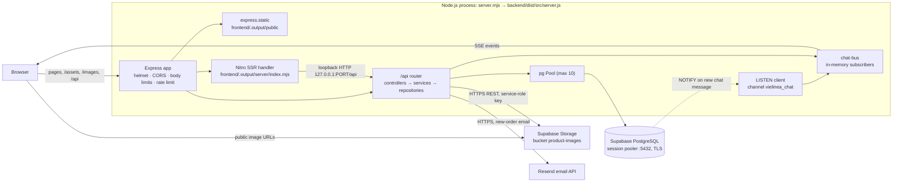
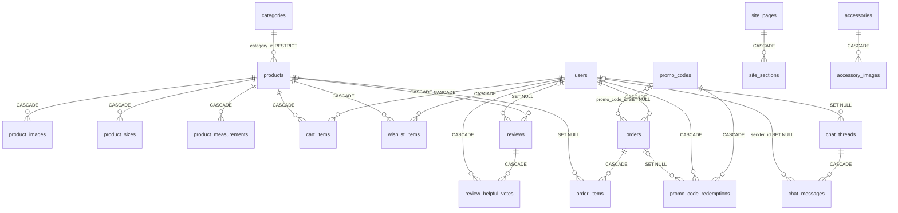
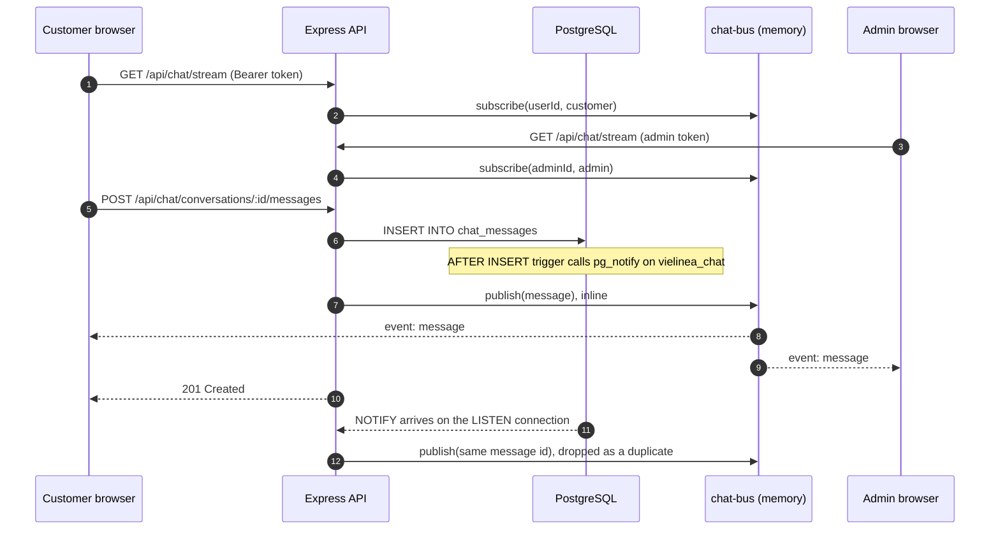

# VIELINEA — Technical Documentation

A reference for developers who maintain, debug or deploy VIELINEA. Every statement here was checked against the source code, configuration files and lockfiles in this repository on **2026-10-23** (branch `main`, working tree including uncommitted changes). Anything that could not be confirmed from the repository is marked **Unverified**.

This document contains no secret values. Environment variables are listed by name only.

For step-by-step setup and request/response details, the existing guides are still useful: [README.md](README.md), [backend/README.md](backend/README.md), [frontend/README.md](frontend/README.md) and [DEPLOYMENT.md](DEPLOYMENT.md). Section M lists the places where those guides, or code comments, no longer match the code.

### Status labels

| Label | Meaning |
| --- | --- |
| **Implemented** | Present in the source and reached by a running code path |
| **Configured only** | Installed or declared, but no running code path uses it |
| **Not implemented** | Absent, or present only as database schema |
| **Unverified** | Could not be confirmed from the repository |

## Contents

- [A. Project overview](#a-project-overview)
- [B. Technology stack](#b-technology-stack)
- [C. Architecture overview](#c-architecture-overview)
- [D. Frontend architecture](#d-frontend-architecture)
- [E. Backend architecture](#e-backend-architecture)
- [F. Database and Supabase](#f-database-and-supabase)
- [G. Authentication and security](#g-authentication-and-security)
- [H. Real-time features and live chat](#h-real-time-features-and-live-chat)
- [I. API reference](#i-api-reference)
- [J. Build, run and deploy](#j-build-run-and-deploy)
- [K. Environment variables](#k-environment-variables)
- [L. Testing and code quality](#l-testing-and-code-quality)
- [M. Known limitations and open items](#m-known-limitations-and-open-items)
- [N. Unverified items](#n-unverified-items)

---

## A. Project overview

VIELINEA is the online store of a premium women's fashion brand. This repository holds the customer storefront, an admin dashboard and the REST API behind both.

**Shoppers can** browse, search and filter the catalogue; view products with sizes, measurements and reviews; browse a separate range of accessories (gift items); keep a cart and wishlist (in the browser as a guest, on the server once signed in); register and sign in; check out with Cash on Delivery; see their order history; and chat live with the shop, signed in or anonymously.

**Administrators can** manage products, accessories, categories, inventory, orders and payment status, customers and reviews; edit homepage hero slides, an Instagram-style image strip, the About-page timeline, FAQs, CMS pages, sections, settings and testimonials, and a media URL library; answer live chat; and view dashboard statistics and charts.

### Verified architecture

- **A monorepo with two npm applications** and a thin root wrapper:
  - `frontend/`: TanStack Start (React 19, Vite 8, Nitro) with server-side rendering (SSR).
  - `backend/`: an Express 4 REST API in TypeScript, layered as controllers, services and repositories, with hand-written SQL through `pg`.
  - Root: [scripts/build.mjs](scripts/build.mjs) and [server.mjs](server.mjs) build both apps and run them as **one Node.js process** in production.
- **Data:** PostgreSQL hosted by Supabase. Only the API connects to it, through the Supabase connection pooler. The browser never talks to the database.
- **Files:** images uploaded by admins go to a public Supabase Storage bucket through Storage's REST API. The seeded catalogue images ship with the frontend in `frontend/public/images/`.
- **Not used:** the Supabase JavaScript client, Supabase Auth and Supabase Realtime. Authentication is the project's own (bcrypt and JWT). Live chat uses Server-Sent Events (SSE) fed by PostgreSQL `LISTEN/NOTIFY`.
- **Payments:** Cash on Delivery works end to end. Card payment is an adapter interface with no real processor behind it, and production refuses it.
- **Email:** an optional new-order notification to the admin, sent through Resend's REST API.
- **Currency:** USD, hard-coded in [order.service.ts](backend/src/services/order.service.ts) and the order email.

### Repository layout

```text
.
├── package.json             Root wrapper: build/start scripts only, no dependencies
├── scripts/build.mjs        Builds backend and frontend for the single-process deploy
├── server.mjs               Production entry point
├── DEPLOYMENT.md            Hosting guide
├── backend/
│   ├── src/
│   │   ├── server.ts        Starts the HTTP server, chat listener and shutdown hooks
│   │   ├── app.ts           Express app factory: middleware, routes, storefront mount
│   │   ├── config/env.ts    Zod-validated environment
│   │   ├── routes/index.ts  Every API route
│   │   ├── controllers/     HTTP layer (16 files)
│   │   ├── services/        Business logic; payment/ and email/ adapters
│   │   ├── repositories/    SQL (16 files)
│   │   ├── middleware/      auth, error, rate-limit, image-upload, validate
│   │   ├── lib/             DB pool, chat bus, cache, Storage upload, errors, HTTP helpers
│   │   ├── schemas/         Zod request schemas
│   │   ├── types/           API and model types
│   │   └── utils/           JWT, password and slug/money helpers
│   ├── scripts/             Migration, seed, verification and end-to-end scripts (run with tsx)
│   └── supabase/
│       ├── migrations/      SQL migrations 0001–0021 (21 files)
│       └── seed/            Catalogue and CMS seed data
└── frontend/
    ├── src/
    │   ├── routes/          File-based routes (40 route files)
    │   ├── router.tsx       Router and per-request QueryClient; SSR dehydrate/hydrate
    │   ├── start.ts         TanStack Start instance and server error middleware
    │   ├── server.ts        SSR server entry wrapper
    │   ├── components/      Storefront components; ui/ holds the shadcn/ui primitives
    │   ├── admin/           Admin shell, services and helpers
    │   ├── contexts/        StoreProvider (auth, cart, wishlist)
    │   ├── services/        Data-fetching hooks, one module per resource
    │   ├── lib/             API client, SSE client, image variants, payments, utilities
    │   └── styles.css       Tailwind v4 theme
    ├── public/              Favicons and seeded catalogue images (89 files, including WebP variants)
    └── vite.config.ts
```

---

## B. Technology stack

Versions are the installed versions recorded in the lockfiles (`package-lock.json`, lockfileVersion 3). The ranges in `package.json` may be looser.

### Frontend (`frontend/`)

| Technology | Version | Purpose | Evidence | Status |
| --- | --- | --- | --- | --- |
| React, React DOM | 19.2.8 | UI rendering, SSR and hydration | [frontend/package.json](frontend/package.json), [__root.tsx](frontend/src/routes/__root.tsx) | Implemented |
| TypeScript | 5.9.3 | Language, `strict` mode | [frontend/tsconfig.json](frontend/tsconfig.json) | Implemented |
| Vite | 8.2.1 (Rolldown 1.2.4) | Dev server and bundler | [vite.config.ts](frontend/vite.config.ts) | Implemented |
| `@lovable.dev/vite-tanstack-config` | 2.8.5 | Ready-made Vite setup: TanStack Start, React, Tailwind, tsconfig paths, Nitro (build only; Cloudflare target by default), `VITE_*` injection, `@` alias, dev port 8080 | Comment in [vite.config.ts](frontend/vite.config.ts) | Implemented |
| TanStack Start (`@tanstack/react-start`) | 1.169.3 | Full-stack React framework: SSR, server entry, request middleware | [start.ts](frontend/src/start.ts), [server.ts](frontend/src/server.ts) | Implemented |
| TanStack Router | 1.170.45 (router-plugin 1.168.47) | File-based routing; generates `routeTree.gen.ts` | [src/routes/](frontend/src/routes/), [router.tsx](frontend/src/router.tsx) | Implemented |
| TanStack Query | 5.101.4 | Server-state cache; SSR prefetch with `ensureQueryData`; dehydrate/hydrate | [router.tsx](frontend/src/router.tsx), [src/services/](frontend/src/services/) | Implemented |
| Nitro | 3.0.260603-beta (pre-release) | Server build output; `node-middleware` preset for production | [scripts/build.mjs](scripts/build.mjs), generated `frontend/.output/nitro.json` | Implemented |
| Tailwind CSS (`@tailwindcss/vite`) | 4.3.3 | Styling, configured in CSS | [styles.css](frontend/src/styles.css) | Implemented |
| tw-animate-css | 1.4.0 | Animation utilities used by the UI primitives | [styles.css](frontend/src/styles.css) | Implemented |
| shadcn/ui ("new-york" style) on Radix UI | Radix, e.g. `react-dialog` 1.1.23 | Component primitives in `src/components/ui/`: 46 files, 18 of them used by app code | [components.json](frontend/components.json) | Implemented (partly used) |
| lucide-react | 0.575.0 | Icons | Imported in 40 app files | Implemented |
| class-variance-authority, clsx, tailwind-merge | 0.7.1, 2.1.1, 3.6.0 | Component variants and the `cn()` class helper | [lib/utils.ts](frontend/src/lib/utils.ts) | Implemented |
| React Context (`StoreProvider`) | — | Session, cart and wishlist state | [store-context.tsx](frontend/src/contexts/store-context.tsx) | Implemented |
| react-hook-form + `@hookform/resolvers` | 7.85.0, 5.9.1 | Forms with Zod schemas: checkout, login, register, contact, profile | e.g. [checkout-dialog.tsx](frontend/src/components/shop/checkout-dialog.tsx) | Implemented |
| Zod | 3.25.76 | Form schemas and route search-param validation (shop, accessories) | [shop.tsx](frontend/src/routes/shop.tsx) | Implemented |
| framer-motion | 12.43.0 | Animations: product and accessory cards, product page, chat widget, shop hero, timeline, reviews | 8 files | Implemented |
| recharts | 2.15.4 | Admin dashboard and analytics charts | [_adminGuard.admin.index.tsx](frontend/src/routes/_adminGuard.admin.index.tsx), [_adminGuard.admin.analytics.tsx](frontend/src/routes/_adminGuard.admin.analytics.tsx) | Implemented |
| sonner | 2.0.8 | Toast notifications | 22 files | Implemented |
| Fontsource: Playfair Display (weight 500), Inter Variable | 5.3.0, 5.3.0 | Self-hosted fonts | [styles.css](frontend/src/styles.css) | Implemented |
| embla-carousel-react, cmdk, vaul, input-otp, react-day-picker, react-resizable-panels | 8.6.0, 1.1.1, 1.1.2, 1.4.2, 9.14.0, 4.12.3 | Back shadcn primitives that no app code imports (the hero carousel is custom) | `src/components/ui/*` | Configured only |
| Redux, Zustand or another state library | — | — | Not in `package.json` | Not used |
| React Router (`react-router-dom`), Next.js | — | — | Not in `package.json`; TanStack Router is the router | Not used |

### Backend (`backend/`)

| Technology | Version | Purpose | Evidence | Status |
| --- | --- | --- | --- | --- |
| Node.js | `engines`: backend `>=20`; root `>=22.12.0 <25` | Runtime; global `fetch` is used for Storage and email | [backend/package.json](backend/package.json), [package.json](package.json) | Implemented |
| Express | 4.22.3 | HTTP server and routing | [app.ts](backend/src/app.ts), [routes/index.ts](backend/src/routes/index.ts) | Implemented |
| TypeScript, tsx | 5.9.3, 4.23.12 | Compiled with `tsc` to `backend/dist`; tsx runs dev mode and scripts | [backend/tsconfig.json](backend/tsconfig.json) | Implemented |
| pg (node-postgres) | 8.23.0 | PostgreSQL driver: pool, transactions, `LISTEN`. No ORM | [lib/db.ts](backend/src/lib/db.ts) | Implemented |
| jsonwebtoken | 9.0.3 | Sign and verify JWTs (issuer `vielinea-api`) | [utils/jwt.ts](backend/src/utils/jwt.ts) | Implemented |
| bcryptjs | 2.4.3 | Password hashing, 10 rounds | [utils/password.ts](backend/src/utils/password.ts) | Implemented |
| Zod | 3.25.76 | Request validation and environment validation | [schemas/index.ts](backend/src/schemas/index.ts), [config/env.ts](backend/src/config/env.ts) | Implemented |
| helmet | 8.3.0 | Security headers (CSP disabled) | [app.ts](backend/src/app.ts) | Implemented |
| cors | 2.8.6 | Origin allowlist with credentials | [app.ts](backend/src/app.ts) | Implemented |
| cookie-parser | 1.4.7 | Reads the auth cookie | [middleware/auth.ts](backend/src/middleware/auth.ts) | Implemented |
| express-rate-limit | 7.5.1 | Rate limits (in-memory store) | [middleware/rate-limit.ts](backend/src/middleware/rate-limit.ts) | Implemented |
| dotenv | 16.6.1 | Loads `backend/.env` | [config/env.ts](backend/src/config/env.ts) | Implemented |
| Server-Sent Events | Hand-written, no library | Live chat push | [chat.controller.ts](backend/src/controllers/chat.controller.ts), [chat-bus.ts](backend/src/lib/chat-bus.ts) | Implemented |
| PostgreSQL `LISTEN/NOTIFY` | — | Source of chat events | [chat-bus.ts](backend/src/lib/chat-bus.ts), [0006_live_chat.sql](backend/supabase/migrations/0006_live_chat.sql) | Implemented |
| Resend (REST over `fetch`, no SDK) | — | Admin new-order email | [resend.provider.ts](backend/src/services/email/resend.provider.ts) | Implemented; active only when `EMAIL_API_KEY` is set |
| Card payment processor | — | Adapter seam plus a development sandbox | [services/payment/](backend/src/services/payment/) | Not implemented |
| `validate()` middleware | — | Generic Zod middleware | [middleware/validate.ts](backend/src/middleware/validate.ts) | Configured only: no route uses it; controllers call `schema.parse` |
| WebSockets (`ws`, socket.io) | — | — | Not in `package.json` | Not used |
| Job queue, scheduler or cron library | — | — | Not in `package.json` | Not used |

### Database and storage

| Technology | Version | Purpose | Evidence | Status |
| --- | --- | --- | --- | --- |
| PostgreSQL hosted on Supabase | Server version Unverified | Primary data store, 31 tables | [backend/supabase/migrations/](backend/supabase/migrations/) | Implemented |
| Supabase connection pooler, session mode (port 5432) | — | Runtime queries, the chat `LISTEN` connection, migrations | [lib/db.ts](backend/src/lib/db.ts), [DEPLOYMENT.md](DEPLOYMENT.md) | Implemented |
| Supabase Storage | — | Public bucket `product-images` for admin uploads, written through REST with the service-role key | [lib/storage.ts](backend/src/lib/storage.ts) | Implemented |
| Row Level Security | — | Enabled, with no policies, on 30 of the 31 tables | Migrations | Implemented (defence in depth) |
| `@supabase/supabase-js` | — | — | Not in either `package.json` | Not used |
| Supabase Auth | — | — | The app has its own `users` table and JWTs | Not used |
| Supabase Realtime | — | — | Header comment in [chat-bus.ts](backend/src/lib/chat-bus.ts) explains why | Not used |
| Supabase CLI and Edge Functions | — | — | No `supabase/config.toml` or functions directory; migrations run through a custom script | Not used |
| Supabase image transformations | — | — | Comment in [image-prepare.ts](frontend/src/admin/lib/image-prepare.ts) says the endpoint answers `FeatureNotEnabled` | Not used (current project setting Unverified) |
| ORM or query builder | — | — | — | Not used |

### Development, build and deployment

| Technology | Version | Purpose | Evidence | Status |
| --- | --- | --- | --- | --- |
| npm | Lockfiles at the root, in `backend/` and in `frontend/` | Package manager used by every build script | `package-lock.json` files | Implemented |
| Bun lockfile | — | `frontend/bun.lock` and `bunfig.toml` (Lovable tooling); builds use npm | [bunfig.toml](frontend/bunfig.toml) | Configured only |
| Root build orchestrator | — | Installs and builds both apps for production | [scripts/build.mjs](scripts/build.mjs) | Implemented |
| ESLint (flat config) + typescript-eslint + react-hooks + react-refresh + prettier plugin | 9.39.5, 8.67.0 | Frontend linting | [eslint.config.js](frontend/eslint.config.js) | Implemented (frontend only) |
| Prettier | 3.9.6 | Frontend formatting | [.prettierrc](frontend/.prettierrc) | Implemented (frontend only) |
| Backend lint and format | — | `eslint-disable` comments exist, but there is no ESLint config or dependency | — | Not configured |
| Type checking | — | Backend: `npm run typecheck`. Frontend: `tsconfig.json` exists, but no script runs `tsc` | `package.json` files | Implemented (backend only) |
| Tests | — | TypeScript end-to-end scripts run with tsx; no Jest, Vitest or Playwright | [backend/scripts/](backend/scripts/) | Implemented (integration scripts only) |
| Continuous integration | — | — | No `.github/workflows` | Not implemented |
| Git / GitHub | — | Remotes `origin` (abed4alrhmanahmad/vielinea) and `godaddy` (abed4alrhmanahmad/vielnea_) | Local git config | Implemented |
| Lovable | — | The project is connected to Lovable; see [AGENTS.md](frontend/AGENTS.md) and `frontend/.lovable/` | [AGENTS.md](frontend/AGENTS.md) | Implemented (tooling) |
| Render | — | A live deployment was observed at `https://vielnea.onrender.com`; no Render config file is in the repo | HTTP check, 2026-10-23 | Unverified from code |
| Docker, Procfile, `render.yaml`, `vercel.json`, `netlify.toml` | — | — | None in the repo | Not present |
| Cloudflare Wrangler | — | Local preview of the default (Cloudflare-target) frontend build; `.wrangler/` state and `wrangler.dev.log` exist locally, port 8788 is mentioned in `backend/.env.example`; no committed config | — | Configured only (local preview) |
| Logging and monitoring | — | `console` output only; health endpoints; no APM, Sentry or log drain | [server.ts](backend/src/server.ts), [middleware/error.ts](backend/src/middleware/error.ts) | Implemented (basic) |

---

## C. Architecture overview

### How the pieces run

| Mode | Processes | How to start |
| --- | --- | --- |
| Local development | Two: the Vite dev server on port 8080 and the API on port 5000 (`tsx watch`) | `npm run dev` in `backend/`, and `npm run dev` in `frontend/` |
| Production | One Node.js process serving the API, static files and SSR on `PORT` | `npm run build`, then `npm start`, at the repository root |

In development the browser calls the API cross-origin (`VITE_API_URL=http://localhost:5000/api`), so `FRONTEND_URL` must allow `http://localhost:8080`, which is its default. In production the storefront is built with `VITE_API_URL=/api`, so browser calls are same-origin.

### Production component diagram



### Request flows

**1. Page request (SSR)**

1. The browser requests a page, for example `/product/<id>`.
2. Express runs helmet and CORS, then `express.static`. Files in `frontend/.output/public` are served at this point and never reach the rate limiter. Other requests continue through the body parsers, cookie parser and general rate limiter.
3. The path is not under `/api`, so the request reaches the Nitro handler, and TanStack Start runs the route's loaders.
4. The loaders call the API **over loopback** (`http://127.0.0.1:$PORT/api/...`) inside the same process. These calls carry no user credentials and are exempt from the rate limiter.
5. React renders the HTML, and the TanStack Query cache is serialised into the page.
6. The browser hydrates, restores the query cache, then starts the signed-in queries (`/auth/me`, cart, wishlist, chat).

**2. API call from the browser**

`fetch("/api/...")` is sent with `credentials: "include"` and, when a token is stored, `Authorization: Bearer <token>`. It passes through the middleware, then the controller (Zod parse), service and repository (`pg`). The response is the JSON envelope `{ success: true, data, pagination? }` or `{ success: false, message, errors? }`.

**3. Admin image upload**

1. The admin picks a file. [image-prepare.ts](frontend/src/admin/lib/image-prepare.ts) downsizes it in the browser to a long edge of at most 2048 px, re-encoded as WebP at quality 0.9. Files that are already within those bounds and at most 600 KB are sent unchanged.
2. The raw bytes are POSTed to `/api/products/images` (or `/api/accessories/images`) with the image's content type.
3. The API buffers up to 15 MB, identifies the format from its magic bytes, rejects SVGs that could run script, and uploads the file to Supabase Storage with the service-role key.
4. The API returns the public URL, which the admin UI then saves on a product, accessory, hero slide, timeline entry or selected image.

**4. Checkout (`POST /api/orders`)**

Checkout runs in one database transaction:

1. Lock the cart's product rows with `FOR UPDATE`.
2. Re-check stock per size.
3. Price every line from the database.
4. Add the flat shipping rate.
5. Card orders only: get the payment authorised.
6. Insert the order and its items.
7. Decrement stock.
8. Clear the cart, then commit.

After the commit, the admin email is sent without blocking the response (section E).

---

## D. Frontend architecture

### Entry points

| File | Role |
| --- | --- |
| [vite.config.ts](frontend/vite.config.ts) | Uses `@lovable.dev/vite-tanstack-config` and points TanStack Start's server entry at `src/server.ts` |
| [src/router.tsx](frontend/src/router.tsx) | `getRouter()`: one router and one `QueryClient` per server request (one pair in the browser), plus dehydrate/hydrate of the query cache |
| [src/start.ts](frontend/src/start.ts) | `createStart()` with a request middleware that turns unexpected server errors into an HTML error page |
| [src/server.ts](frontend/src/server.ts) | Server `fetch` entry wrapping TanStack Start; turns h3's generic JSON 500 into the HTML error page |
| [src/routes/__root.tsx](frontend/src/routes/__root.tsx) | HTML document shell, default `<head>` tags, `QueryClientProvider`, `StoreProvider`, toaster, root error and 404 components |
| [src/routeTree.gen.ts](frontend/src/routeTree.gen.ts) | Generated route tree; do not edit |

### Routes

| URL | Route file | Purpose | Data in the server-rendered HTML | Access |
| --- | --- | --- | --- | --- |
| `/` | `index.tsx` | Home: hero carousel, product rows, accessories, testimonials, image strip | CMS home page, hero slides, testimonials, selected images, three product lists, accessories, categories | Public |
| `/shop` | `shop.tsx` | Catalogue with search, category filter, sort and pagination (Zod-validated search params) | Categories only; the product grid loads in the browser | Public |
| `/product/$id` | `product.$id.tsx` | Product detail by id or slug: sizes, reviews, related products | The product, plus a title, description and Open Graph tags built from it | Public |
| `/accessories` | `accessories.tsx` | Accessory listing | The accessory list for the current search params | Public |
| `/about` | `about.tsx` | Brand story, company timeline, FAQs | CMS About page, timeline, FAQs | Public |
| `/faq` | `faq.tsx` | FAQ page | FAQ content, `FAQPage` JSON-LD and a canonical link | Public |
| `/contact` | `contact.tsx` | Contact form | CMS contact page | Public |
| `/cart`, `/wishlist` | `cart.tsx`, `wishlist.tsx` | Bag and wishlist | — | Public (guest data in localStorage) |
| `/login`, `/register` | `login.tsx`, `register.tsx` | Customer sign-in and registration | — | Public |
| `/account`, `/account/orders`, `/account/orders/$id`, `/account/wishlist`, `/account/messages`, `/account/profile` | `account*.tsx` | Customer area | — | Signed-in customers (client-side `RequireAuth`) |
| `/admin/login` | `admin.login.tsx` | Admin sign-in | — | Public |
| `/admin` and 18 sub-pages | `_adminGuard.tsx`, `_adminGuard.admin.*.tsx` | Admin dashboard | — | Admins (client-side guard; every admin API call is also checked on the server) |

Admin sub-pages: accessories, analytics, categories, chat, content, customers, faqs, hero-slides, homepage, inventory, media, notifications, orders, products, reviews, selected-images, settings, timeline.

### SSR and hydration

- **Rendering:**
  - Every route is server-rendered. No route sets `ssr: false`, and SPA mode is not enabled.
  - The root loader prefetches site settings, so the header, footer and announcement bar are in the HTML of every page.
  - Routes without a loader are still rendered on the server, but only as their layout and loading states. Their data is fetched in the browser.
- **Hydration:** the server's TanStack Query cache is written into the page as a JSON string (`dehydrate`) and restored in the browser (`hydrate`). This keeps the first client render identical to the server HTML.
- **Credentials:** SSR API calls are anonymous. The server-side `fetch` sends no `Authorization` header (there is no localStorage on the server) and does not forward the browser's cookies. Authenticated queries stay disabled until the browser has hydrated, so no customer data is ever written into the HTML.
- **API origin:** SSR reaches the API at `INTERNAL_API_ORIGIN`, or at `http://127.0.0.1:$PORT` when that is unset ([client.ts](frontend/src/lib/api/client.ts)).

### Component organisation

| Directory | Contents |
| --- | --- |
| `src/components/layout/` | `Shell` (header, footer, chat widget), account menu, logo |
| `src/components/shop/` | Product and accessory cards, checkout dialog, product reviews, shop hero |
| `src/components/home/` | Hero carousel (custom timers and transitions; no carousel library) |
| `src/components/about/`, `faq-accordion.tsx` | Company timeline, FAQ accordion |
| `src/components/chat/` | Chat widget for guests and signed-in customers |
| `src/components/account/`, `src/components/auth/` | Account panels, `RequireAuth` |
| `src/components/responsive-image.tsx` | `<picture>` with WebP variants |
| `src/components/ui/` | 46 shadcn/ui primitives; app code uses 18 of them (accordion, badge, button, card, chart, dialog, dropdown-menu, input, label, popover, select, sheet, sidebar, skeleton, sonner, switch, tabs, textarea) |
| `src/admin/` | `AdminShell`, one service module per admin resource, `api-hooks.ts`, `image-prepare.ts` |

### State management

There is no global state library. State lives in three places:

| State | Where | Persistence |
| --- | --- | --- |
| Server data (products, CMS content, orders, chat…) | TanStack Query cache | Memory |
| Session, cart, wishlist | `StoreProvider` in [store-context.tsx](frontend/src/contexts/store-context.tsx) | **Signed in:** on the server (`/api/cart`, `/api/wishlist`). **Guest:** localStorage `v_cart` and `v_wishlist`, merged into the account at sign-in through `/api/cart/merge` and `/api/wishlist/merge` |
| Tokens | localStorage | `v_token` (JWT), `vielinea_guest_chat_token` (guest chat), `vielinea_admin_session` (admin UI hint only) |

### API client and data fetching

- [src/lib/api/client.ts](frontend/src/lib/api/client.ts) is the single `fetch` wrapper:
  - Adds `Authorization: Bearer` from localStorage and sends `credentials: "include"`.
  - Unwraps the `{ success, data, pagination }` envelope and throws `ApiError` (status plus field errors).
  - `errorMessage()` turns an error into toast text.
- **Base URL:** `VITE_API_URL`, inlined at build time, falling back to `http://localhost:5000/api`. During SSR a relative value such as `/api` is resolved against the loopback origin.
- **Per-resource modules:** each file in `src/services/*.ts` exports `queryOptions` and hooks for one resource. Route loaders reuse the same options through `ensureQueryData`, so SSR and the browser share cache keys. [mappers.ts](frontend/src/lib/api/mappers.ts) converts API shapes into the storefront's component types.
- **Admin:** [api-hooks.ts](frontend/src/admin/lib/api-hooks.ts) adapts TanStack Query to the admin components' original synchronous service interface. Image uploads call `fetch` directly with the raw file body ([products-admin.ts](frontend/src/admin/services/products-admin.ts)).
- **Live chat** has its own streaming client, [chat-stream.ts](frontend/src/lib/api/chat-stream.ts) (section H).
- **QueryClient defaults:** the `QueryClient` is created with no custom default options, so TanStack Query's defaults apply.

### Error and loading states

- **Route errors:** a root `errorComponent` offers retry and a link home. There are root and product `notFoundComponent`s, and the product route has its own error component.
- **Server errors:** unexpected SSR errors render a static HTML error page (`renderErrorPage()`, from `start.ts` and `server.ts`).
- **Loading:** skeletons (`ui/skeleton`), a "Loading admin..." screen while the admin session is verified, and a spinner in `RequireAuth`.
- **Account area:** `ErrorPanel` with a retry button appears when the session cannot be confirmed, for example offline, instead of signing the user out.
- **Notifications:** sonner toasts for mutations and API errors.
- **Error reporting:** `reportLovableError()` forwards error-boundary errors to `window.__lovableEvents` when the Lovable editor injects it. Everywhere else it does nothing.

### Styling

- **Tailwind CSS v4, configured in CSS** ([styles.css](frontend/src/styles.css)). `@theme inline` maps design tokens (OKLCH CSS variables) to utilities. There is no `tailwind.config.js`.
- **shadcn/ui** uses the "new-york" style with CSS variables ([components.json](frontend/components.json)) and the `cn()` helper.
- **Fonts** are self-hosted through Fontsource: Playfair Display, weight 500 only, for headings and `font-display`; Inter Variable for body text.

### Images and optimisation

- **Seeded catalogue images** live in `frontend/public/images/` and are served as static files (`/images/...`).
  - Pre-built `-<width>.webp` variants exist for them. [image-variants.ts](frontend/src/lib/image-variants.ts) is the manifest, and [responsive-image.tsx](frontend/src/components/responsive-image.tsx) renders a `<picture>` with `srcset` when a URL is listed in it.
  - The manifest says it is generated, but the generator is not in the repository (Unverified how to regenerate it).
- **Brand, hero and Instagram images** in `src/assets/` are imported by components and bundled by Vite. They are content-hashed under `/assets/` and cached for one year in production.
- **Admin uploads** are downscaled in the browser before upload (section C, flow 3). Supabase Storage then serves them byte for byte, with `Cache-Control: public, max-age=31536000, immutable`.

### SEO and metadata

- **Defaults (root):** title, description, Open Graph (title, description, type, site name), a Twitter card and favicons.
- **Per route:** public pages set their own titles and descriptions, and several set Open Graph tags. Product pages build their title, description and Open Graph tags from the product.
- **Not indexed:** account pages, admin pages, and a product page that failed to load carry `robots: noindex`.
- **Structured data:** `/faq` has `FAQPage` JSON-LD and a canonical link.
- **Missing:** `frontend/public/` has no `robots.txt` and no sitemap (Not implemented).

---

## E. Backend architecture

### Startup ([server.ts](backend/src/server.ts))

1. [config/env.ts](backend/src/config/env.ts) loads `backend/.env` with dotenv and validates it with Zod. If validation fails, it exits and names the failing variables.
2. `loadFrontend()` ([lib/frontend.ts](backend/src/lib/frontend.ts)) imports the Nitro build when `FRONTEND_OUTPUT_DIR` is set, which `server.mjs` does in production. Otherwise the server runs API-only.
3. `createApp({ frontend })` builds the Express app.
4. `app.listen(PORT, HOST)` starts the server. `HOST` defaults to `0.0.0.0` in production.
5. After it starts listening, the server:
   - runs one `SELECT 1` to report database connectivity;
   - logs the email configuration;
   - calls `startChatListener()`, which opens the `LISTEN` connection and keeps retrying in the background if that fails.
6. On `SIGINT` or `SIGTERM` it stops accepting connections, closes the chat listener and the pool, then exits. Exit is forced after 10 s.

### Middleware pipeline ([app.ts](backend/src/app.ts)), in order

1. `trust proxy = 1` (production only)
2. `x-powered-by` disabled
3. helmet: CSP off, `Cross-Origin-Resource-Policy: cross-origin`
4. CORS allowlist from `FRONTEND_URL`:
   - credentials allowed;
   - methods `GET POST PUT PATCH DELETE OPTIONS`;
   - headers `Content-Type`, `Authorization`, `X-Guest-Token`.
5. Static storefront files (single-process mode only); files under `/assets/` are cached for a year
6. `express.json` and `express.urlencoded`, 100 kB limit each
7. cookie-parser
8. General rate limiter. In single-process mode, loopback requests without `X-Forwarded-For` are exempt.
9. `GET /` JSON banner (API-only mode)
10. The `/api` router
11. Single-process mode only: unknown `/api` paths get a JSON 404, and every other path goes to the Nitro SSR handler
12. 404 handler, then the central error handler

### Layers

| Layer | Location | Responsibility |
| --- | --- | --- |
| Routes | [routes/index.ts](backend/src/routes/index.ts) | Paths and per-route middleware. The admin sub-router (`/api/admin`) applies `authenticate` + `authorizeAdmin` once for all its routes. |
| Controllers | [controllers/](backend/src/controllers/) | Parse params and body with Zod, call a service, send the envelope (`sendData`, `sendPaginated`); wrapped in `asyncHandler`. The admin and CMS controllers also call repositories directly. |
| Services | [services/](backend/src/services/) | Business rules, ownership checks, caching, payments, email |
| Repositories | [repositories/](backend/src/repositories/) | Parameterised SQL through [lib/db.ts](backend/src/lib/db.ts); map rows to models |
| Schemas | [schemas/index.ts](backend/src/schemas/index.ts) | Zod request schemas |
| Lib | [lib/](backend/src/lib/) | DB pool, chat bus, cache, Storage upload, error classes, HTTP helpers, storefront loader |

### Validation

- Controllers parse every input with a Zod schema (`schema.parse(...)`). A failure becomes a 422 with per-field errors.
- Email addresses are trimmed and lower-cased. Ids and slugs are restricted to `[a-zA-Z0-9._-]`, and UUID path parameters are checked where a UUID is required.
- `cardTokenSchema` is `.strict()`, so a request that includes a card number or CVV is rejected.

### Error handling ([middleware/error.ts](backend/src/middleware/error.ts))

| Error | Status | Message sent to the client |
| --- | --- | --- |
| `ZodError` | 422 | "Validation failed", plus `errors: [{ path, message }]` |
| `AppError` and its subclasses | Their own status: 400, 401, 402 (card declined), 403, 404, 409, 413, 422, 502 (Storage failure), 503 (payment unavailable) | Their own message |
| Postgres `23505` unique violation | 409 | "That record already exists" |
| Postgres `23503` foreign key | 400 | "Referenced record does not exist" |
| Postgres `23514` check violation | 422 | "One or more values are outside the allowed range" |
| Postgres `22P02` bad input | 400 | "Malformed identifier" |
| body-parser and other HTTP errors | Their status | 413 "Payload too large", 400 "Malformed request body" |
| Anything else | 500 | "Something went wrong" |

Stack traces are never sent to the client. Errors with status 500 or above are logged with their stack; 4xx responses are logged only in development.

### Rate limiting ([middleware/rate-limit.ts](backend/src/middleware/rate-limit.ts))

| Limiter | Window | Production limit | Development limit | Applied to |
| --- | --- | --- | --- | --- |
| General | 15 min | 600 requests | 5000 | Every API and page request; static files are served before it |
| Auth | 15 min | 20 failed attempts (successful requests are not counted) | 200 | Register, login, password change, email change |
| Write | 60 min | 30 requests | 500 | Profile update, review create and report, guest chat start and send, contact form, newsletter |

The store is in memory, so limits are per process and reset on restart. Clients are keyed by IP, with `trust proxy = 1` in production.

### Caching ([lib/cache.ts](backend/src/lib/cache.ts) and per-service caches)

| Data | TTL | Cleared when | File |
| --- | --- | --- | --- |
| Product lists | 5 min | Products are written or reviews change | [product.service.ts](backend/src/services/product.service.ts) |
| Category list | 5 min | Categories are written | [category.controller.ts](backend/src/controllers/category.controller.ts) |
| Active hero slides | 5 min | Hero slides are written | [hero-slide.service.ts](backend/src/services/hero-slide.service.ts) |
| Active selected images | 5 min | Selected images are written | [selected-image.service.ts](backend/src/services/selected-image.service.ts) |
| CMS public settings, pages, testimonials | 5 min | An admin edits CMS content | [cms.controller.ts](backend/src/controllers/cms.controller.ts) |
| Shipping flat rate | 30 s | Store settings are updated | [cart.service.ts](backend/src/services/cart.service.ts) |

All caches live in process memory, which is only correct for a single instance.

### Business rules worth knowing

- **Prices and stock:**
  - Prices, discounts, stock and totals are always read from the database, never taken from the request.
  - Stock is held per size (`product_sizes`) and capped by the product's overall stock. Checkout decrements both.
- **Shipping:** one flat rate from `store_settings`, charged whenever the subtotal is above zero. Migration 0014 removed free delivery.
- **Orders:**
  - Order numbers have the form `VLN-YYYYMMDD-NNNN`: random, and retried on collision.
  - Order statuses are `pending`, `paid`, `processing`, `shipped`, `delivered` and `cancelled`. Payment status is `pending` or `paid`; payment method is `card` or `cod`.
  - Cash on Delivery orders open as `pending`/`pending`, and an admin marks them paid later. Card orders open as `paid`/`paid`, and only after the provider authorises the payment.
- **Payment methods:** an admin can switch each method off (the `site_content` key `payment_methods`). Card is offered only when it is switched on *and* a real provider is configured.
- **Reviews:**
  - New reviews take the database default status `approved`, so they are published immediately. Admins can set them to `pending` or `hidden`, or delete them.
  - Hidden reviews are left out of public listings.
  - A trigger keeps `products.rating` and `review_count` in sync.
  - `verified` is set when the reviewer has a non-cancelled order for the product.
- **Contact form and newsletter:** submissions are only stored; nothing is emailed. New contact messages appear in admin notifications (name and subject only).
- **Admin notifications:** built on request from the latest orders, products with stock of 5 or less, new contact messages and the latest reviews. There is no notifications table.

### Payments ([services/payment/](backend/src/services/payment/))

| `PAYMENT_PROVIDER` | Behaviour |
| --- | --- |
| `unconfigured` (default) | Card checkout is refused with 503. Cash on Delivery is unaffected. |
| `sandbox` | Test stand-in that moves no money. The outcome depends on the last four digits: 4242 approves, 0002 and 9995 decline, 0119 is a provider error. It replays results by idempotency key, in memory. Production never offers it, and resolving it in production throws. |

- **What the API receives:** the browser is meant to tokenise the card. `tokenizeCard()` in [card.ts](frontend/src/lib/payments/card.ts) is the seam for a provider's SDK. The API accepts only `{ token, brand, last4, expiryMonth, expiryYear }`.
- **What is stored:** the database keeps only the provider reference, the card brand and the last four digits (migration 0016).
- **Adding a real processor:** implement `CardPaymentProvider.authorize`, register it in [payment/index.ts](backend/src/services/payment/index.ts), add its name to the `PAYMENT_PROVIDER` enum, and replace `tokenizeCard()`. [backend/README.md](backend/README.md) lists the steps.

### Email ([services/email/](backend/src/services/email/))

- **Provider:** chosen by whether `EMAIL_API_KEY` is set.
  - Set: Resend (`POST https://api.resend.com/emails`, 10-second timeout).
  - Unset: a disabled provider that logs and skips.
- **Messages:** two, sent independently after the checkout transaction commits and not awaited, so neither fails or slows a checkout, and one failing never stops the other.
  - "New VIELINEA Order …" to `ORDER_NOTIFICATION_EMAIL` (or `ADMIN_EMAIL` when that is unset).
  - "Your VIELINEA order …" to the customer. Skipped while `EMAIL_FROM` is Resend's test sender (`onboarding@resend.dev`), which only reaches the Resend account owner; it needs a sender on a domain verified in Resend.
  - Transient failures (no response, 429, 5xx) are retried twice; every send carries an idempotency key per order and kind, so retries never duplicate. Logs mask addresses.
  - Customer input is HTML-escaped.
- **Not implemented:** password reset and email verification emails.

### Background work

There is no job queue, scheduler, cron job or worker. The only timers are:

- the SSE keep-alive, every 25 s for each open stream;
- the backoff for reconnecting the `LISTEN` connection (1 s up to 30 s);
- the forced-exit timer on shutdown.

The order email is fire-and-forget inside the request's process.

---

## F. Database and Supabase

### Connection

| Item | Value | Evidence |
| --- | --- | --- |
| Driver | `pg` 8.23.0 `Pool`; no ORM | [lib/db.ts](backend/src/lib/db.ts) |
| Target | Supabase connection pooler in session mode, port 5432 (the actual host comes from the environment) | [DEPLOYMENT.md](DEPLOYMENT.md), code comments |
| Credentials | `DB_HOST`, `DB_PORT`, `DB_USER`, `DB_PASSWORD`, `DB_NAME`; `DATABASE_URL` is used when host, user or password is missing | [config/env.ts](backend/src/config/env.ts) |
| TLS | `ssl: { rejectUnauthorized: false }`: the connection is encrypted, but the server certificate is not verified | [lib/db.ts](backend/src/lib/db.ts) |
| Pool settings | Max 10 clients, 30 s idle timeout, 15 s connection timeout, `application_name=vielinea-api` | [lib/db.ts](backend/src/lib/db.ts) |
| Other connections | One dedicated `pg.Client` for `LISTEN vielinea_chat`; migration and test scripts open their own clients | [chat-bus.ts](backend/src/lib/chat-bus.ts), [scripts/](backend/scripts/) |
| Type parsing | `numeric` and `int8` are returned as JavaScript numbers | [lib/db.ts](backend/src/lib/db.ts) |
| `DATABASE_POOL_URL` | Declared in `env.ts` but **not used** by the pool | [config/env.ts](backend/src/config/env.ts) |

Each running instance can hold up to 11 connections to the session pooler. Several instances, or a local backend pointed at the production database, can exhaust the pooler. Requests then wait 15 s and fail with HTTP 500 ([DEPLOYMENT.md](DEPLOYMENT.md), "Database connections").

### Query layer

[lib/db.ts](backend/src/lib/db.ts) exposes:

- `query`, `queryOne` and `queryMany`: parameterised queries; user input is never interpolated into SQL;
- `withTransaction`: `BEGIN`/`COMMIT`/`ROLLBACK` on a dedicated client; used by checkout.

All SQL lives in the repositories.

### Schema

The migrations create 31 tables in the `public` schema.

| Area | Tables |
| --- | --- |
| Users | `users` |
| Catalogue | `categories`, `products`, `product_images`, `product_sizes`, `product_measurements` |
| Accessories | `accessories`, `accessory_images` |
| Shopping | `cart_items`, `wishlist_items` |
| Orders | `orders`, `order_items` |
| Reviews | `reviews`, `review_helpful_votes` |
| Promotions (schema only) | `promo_codes`, `promo_code_redemptions` |
| Live chat | `chat_threads`, `chat_messages` |
| CMS and content | `site_pages`, `site_sections`, `site_content`, `store_settings`, `testimonials`, `media_assets`, `hero_slides`, `company_timeline`, `faqs`, `selected_images` |
| Inbound | `contact_messages`, `newsletter_subscribers` |
| Bookkeeping | `schema_migrations` |

Foreign keys, with their `ON DELETE` behaviour:



Rules worth knowing:

- **Deleting a user deletes their orders** (`orders.user_id ... ON DELETE CASCADE`), cart and wishlist. Their reviews and chat threads remain, with the user reference set to NULL.
- **Order items keep a snapshot** of title, slug, image, size and prices, so order history survives product deletion.
- **A category cannot be deleted while products use it** (`RESTRICT`). The API checks first and returns 409 with an explanation.
- **Users:** email is unique case-insensitively (`lower(email)`), and `role` is `customer` or `admin`.
- **Chat:**
  - A signed-in user has at most one open thread (a partial unique index).
  - Guest threads have `user_id` NULL, a unique `guest_token_hash` and a unique `anonymous_number` drawn from the sequence `chat_anonymous_number_seq`.
- **CHECK constraints** enforce, among others, stock ≥ 0, discount 0–100, review rating 1–5, cart quantity 1–99, and the allowed status values.

### Triggers and functions

| Function | Trigger table | Effect |
| --- | --- | --- |
| `set_updated_at()` | Most tables | Maintains `updated_at` |
| `sync_review_helpful_count()` | `review_helpful_votes` | Keeps `reviews.helpful_count` current |
| `sync_promo_used_count()` | `promo_code_redemptions` | Keeps the promo usage count (schema only) |
| `sync_product_rating()` / `reviews_sync_product_rating()` | `reviews` | Keeps `products.rating` and `review_count` current |
| `chat_touch_thread()` | `chat_messages` | Updates the thread's last activity |
| `chat_notify_message()` | `chat_messages`, `AFTER INSERT` | Calls `pg_notify('vielinea_chat', <json>)` for live chat |

### Migrations

- **What and how:** plain SQL files in [backend/supabase/migrations/](backend/supabase/migrations/), applied by `npm run db:migrate` ([scripts/migrate.ts](backend/scripts/migrate.ts)), not by the Supabase CLI.
- **Ordering and bookkeeping:** files run in filename order, each in its own transaction, and applied versions are recorded in `public.schema_migrations`.
  - Two files share the number 0006 (`0006_cms_pages.sql`, `0006_live_chat.sql`) and there is no 0005. The full filename decides the order.
  - Their headers say each file can be re-run safely: `IF NOT EXISTS`, and no `DROP TABLE` or `DELETE`.
- **What's missing:** there are no down or rollback migrations.
- **Where they must run:** against the session pooler. The script's comment notes that DDL is not supported through the transaction pooler.
- **When they run:** neither the build nor the start script runs migrations automatically.

### Seeding

| Script | npm script | What it does |
| --- | --- | --- |
| [scripts/seed.ts](backend/scripts/seed.ts) | `db:seed` | Upserts categories, products and images from [supabase/seed/catalog.ts](backend/supabase/seed/catalog.ts). Creates the admin (`ADMIN_EMAIL`/`ADMIN_PASSWORD`) and the demo customer (`DEMO_USER_EMAIL`/`DEMO_USER_PASSWORD`); existing accounts keep their passwords. |
| [scripts/seed-cms.ts](backend/scripts/seed-cms.ts) | None; run it with `npx tsx scripts/seed-cms.ts` | Seeds CMS settings, pages, sections and testimonials from [supabase/seed/cms.ts](backend/supabase/seed/cms.ts). `--force` resets the content to the seed. |
| — | `db:setup` | Runs `db:migrate`, then `db:seed`, then `db:verify` |

The hero-slide, timeline and FAQ migrations also insert default rows when their tables are empty.

### Supabase Storage

- **Bucket:** `product-images`, public. It holds images for products, accessories, hero slides, timeline entries and selected images.
- **Upload:** `POST {SUPABASE_URL}/storage/v1/object/product-images/<uuid>.<ext>` with the service-role key ([lib/storage.ts](backend/src/lib/storage.ts)). The database stores the public URL, `{SUPABASE_URL}/storage/v1/object/public/product-images/<uuid>.<ext>`.
- **Accepted files:**
  - Formats: JPEG, PNG, WebP, GIF, AVIF and SVG, detected from magic bytes.
  - SVGs containing scripts, event handlers, `foreignObject` or `javascript:` links are rejected.
  - Maximum size is 15 MB.
- **Not in code:**
  - No migration or script creates the bucket. Its configuration (public access, and the 15 MB limit a code comment mentions) is Unverified.
  - Deleting a record or a media entry does not delete the stored file; no delete call exists.
- **Media library:** the admin media library (`media_assets`) stores names and URLs only. It does not upload files.

### Supabase features not used

| Feature | Status | Notes |
| --- | --- | --- |
| `@supabase/supabase-js` | Not used | Not in either `package.json` |
| Supabase Auth | Not used | The app has its own `users` table and JWTs |
| Supabase Realtime | Not used | [chat-bus.ts](backend/src/lib/chat-bus.ts) explains why: Realtime scopes subscriptions with RLS and Supabase Auth JWTs, which this app does not issue |
| Data API (PostgREST) | Not used by the app | — |
| Supabase CLI, Edge Functions | Not used | — |

`SUPABASE_ANON_KEY` is read only by [scripts/check.ts](backend/scripts/check.ts).

### Row Level Security

- **Coverage:** RLS is enabled, with no policies, on every table except `schema_migrations` (30 of 31 tables).
- **Effect:** Supabase's `anon` and `authenticated` roles, which the Data API uses with the anon key, can read nothing from those tables. The API connects as a privileged role that bypasses RLS, so all authorisation is enforced in Express.
- **Gap:** `schema_migrations` has no RLS. Whether the project's Data API exposes it is Unverified; enabling RLS on it would close the gap.

### Backups

The repository contains no backup or export tooling. Backups depend on the Supabase project's plan and settings, which are Unverified.

---

## G. Authentication and security

### Sign-in flow

1. The client calls `POST /api/auth/register` or `POST /api/auth/login` (both behind the auth rate limiter).
2. Passwords are hashed with bcryptjs at 10 rounds. For an unknown email, login still compares against a dummy hash and returns the same error, so neither timing nor the message reveals which addresses are registered.
3. The API returns `{ user, token }` and also sets the `vielinea_token` cookie.
4. The browser stores the token in localStorage (`v_token`) and sends it as `Authorization: Bearer` on every call. The API falls back to the cookie when no header is present.
5. On page load, `GET /api/auth/me` confirms the session.
6. `POST /api/auth/logout` clears the cookie, and the client deletes its stored token.

Admins sign in through the same endpoint, from `/admin/login`. The admin UI rejects non-admin accounts and re-checks with `/api/auth/me` before it renders any admin page.

### Tokens

| Property | Value |
| --- | --- |
| Format | JWT signed with HMAC using `JWT_SECRET` (at least 32 characters); issuer `vielinea-api`, checked on verify |
| Claims | `sub` (user id), `email`, `role` (`customer` or `admin`) |
| Lifetime | `JWT_EXPIRES_IN`, default `7d` |
| Cookie | `vielinea_token`: `httpOnly`, path `/`, 7-day max-age (hard-coded). Production adds `Secure` and `SameSite=Strict`; development uses `SameSite=Lax`. |
| Re-issue | After a profile or email change, because the email is in the token |
| Revocation | None. A token stays valid until it expires, including after logout or a password change. |

### Authorisation

| Mechanism | Where | Rule |
| --- | --- | --- |
| `authenticate` | [middleware/auth.ts](backend/src/middleware/auth.ts) | A valid JWT is required, from the header or the cookie |
| `optionalAuthenticate` | Product review listing | Attaches the user when a valid token is present; never rejects |
| `authorizeAdmin` | Everything under `/api/admin`, and catalogue and content writes | `role === "admin"`, read from the token with no database lookup |
| Ownership checks | Services | Orders: a customer reads only their own (admins read any). Reviews: delete your own (admins delete any). Chat: your own thread, or the thread matching your guest-token hash. Profile edits use the token's user id, never one from the body. |
| Not-found masking | Chat | Another user's conversation returns the same 404 as a missing one |
| Client-side guards | `RequireAuth`, `_adminGuard` | User experience only; the server enforces every rule |

### Security controls in place

| Control | Detail | Evidence |
| --- | --- | --- |
| Security headers | helmet defaults: HSTS (1 year, subdomains), `X-Frame-Options: SAMEORIGIN`, `X-Content-Type-Options: nosniff`, `Referrer-Policy: no-referrer`, `Cross-Origin-Opener-Policy: same-origin`. Verified on the live site on 2026-10-23. | [app.ts](backend/src/app.ts) |
| CORS | Explicit allowlist from `FRONTEND_URL`; other origins get no CORS headers | [app.ts](backend/src/app.ts), [e2e-cors.ts](backend/scripts/e2e-cors.ts) |
| Rate limits | General, auth and write limiters (section E) | [rate-limit.ts](backend/src/middleware/rate-limit.ts) |
| Body limits | JSON and form bodies 100 kB; image uploads 15 MB | [app.ts](backend/src/app.ts), [image-upload.ts](backend/src/middleware/image-upload.ts) |
| Input validation | Zod on every controller; the card schema rejects unknown fields | [schemas/index.ts](backend/src/schemas/index.ts) |
| SQL injection | Parameterised queries only | [lib/db.ts](backend/src/lib/db.ts) |
| Error hygiene | No stack traces or schema details in responses | [middleware/error.ts](backend/src/middleware/error.ts) |
| Card data | Card number and CVV never reach the API; only the provider reference, brand and last four digits are stored | [payment/provider.ts](backend/src/services/payment/provider.ts) |
| Uploads | Magic-byte detection, SVG script check, random UUID object names, admin-only | [lib/storage.ts](backend/src/lib/storage.ts) |
| Email | Customer input is HTML-escaped in both order emails; logs mask addresses | [order-notification.ts](backend/src/services/email/order-notification.ts), [order-confirmation.ts](backend/src/services/email/order-confirmation.ts), [deliver.ts](backend/src/services/email/deliver.ts) |
| Guest chat tokens | 32 random bytes; only a SHA-256 hash is stored | [chat.service.ts](backend/src/services/chat.service.ts) |
| Secrets | Server environment only, validated at boot; `.env*` is git-ignored except the `.env.example` files; the frontend environment holds only `VITE_API_URL` | [.gitignore](.gitignore), [frontend/.env.example](frontend/.env.example) |
| Database exposure | RLS deny-by-default (section F) | Migrations |
| Payment sandbox | Refused in production | [payment/index.ts](backend/src/services/payment/index.ts) |

### Absent, unverified, or needing review

These are findings only; no code was changed.

| # | Item | Detail |
| --- | --- | --- |
| 1 | No Content-Security-Policy | helmet's CSP is disabled and the storefront sets no policy of its own. |
| 2 | JWT kept in localStorage | Any script running on the page can read it (XSS exposure), and with no CSP nothing limits which scripts can run. |
| 3 | No session revocation | Logout, a password change or a role change does not invalidate tokens already issued (default lifetime 7 days). The admin role is trusted from the token. |
| 4 | Admin sign-in hardening | No multi-factor authentication. No lockout beyond the auth rate limiter (20 failed attempts per 15 minutes per IP). |
| 5 | Weak customer password rule | Minimum 6 characters (8 for admins). |
| 6 | No password reset and no email verification | Neither flow exists. |
| 7 | No CSRF token | In production this relies on the `SameSite=Strict` cookie and the bearer-header pattern; development uses `Lax`. Review if the cookie settings change. |
| 8 | Database TLS not verified | `rejectUnauthorized: false` on the pool, the `LISTEN` client and the scripts. |
| 9 | In-memory protections | Rate limits and sandbox idempotency reset on restart and are not shared between instances. Whether client IPs are correct depends on `trust proxy = 1` matching the host's proxy chain (Unverified for each host). |
| 10 | Demo customer | `db:seed` creates it with a weak built-in default password unless `DEMO_USER_PASSWORD` is overridden. The test scripts sign in as this user, so change its password rather than deleting it. |
| 11 | `schema_migrations` has no RLS | See section F. |
| 12 | Guest token accepted in the query string | The guest stream also accepts `?guestToken=` (the frontend uses the header). URLs can end up in proxy logs. |
| 13 | SVG uploads | Filtered by pattern matching, not by a full sanitiser. |
| 14 | No audit log | Admin actions are not recorded. |
| 15 | No dependency scanning | No CI or automated vulnerability checks are configured. |

---

## H. Real-time features and live chat

### Transport

Live chat uses Server-Sent Events: one long-lived HTTP response per client. The browser reads the stream with `fetch()` and a `ReadableStream` ([chat-stream.ts](frontend/src/lib/api/chat-stream.ts)) rather than `EventSource`, so that it can send the `Authorization` or `X-Guest-Token` header. There are no WebSockets, no polling and no Supabase Realtime.

| Stream | Endpoint | Credential | Receives |
| --- | --- | --- | --- |
| Signed-in customer | `GET /api/chat/stream` | Bearer JWT | Events for threads the customer owns |
| Admin | `GET /api/chat/stream` | Bearer JWT with role `admin` | Events for every thread |
| Guest | `GET /api/chat/guest/stream?id=<conversationId>` | `X-Guest-Token` header | Events for that one thread; ownership is checked before the stream opens |

### Opening and closing a stream

- The server sends `Content-Type: text/event-stream`, `Cache-Control: no-cache, no-transform` and `X-Accel-Buffering: no`, then a `retry: 3000` line and an `event: ready` frame.
- The connection is registered in the chat bus, and a `: keep-alive` comment frame is written every 25 s.
- When the client disconnects (`close` or `error`), the keep-alive timer stops and the subscription is removed.
- Events are `event: message` and `event: read`, with JSON in the `data:` line.

### Who opens a stream

- **Signed-in customers:** the chat widget is mounted in the storefront layout ([shell.tsx](frontend/src/components/layout/shell.tsx)), so every signed-in customer holds a stream on every storefront page (`useChatStream(isAuthenticated)`).
- **Guests:** a stream opens once the visitor has started a guest conversation.
- **Admins:** the stream opens on the admin chat page only ([admin/services/chat.ts](frontend/src/admin/services/chat.ts)). That page also fetches the transcript of every conversation, one request per conversation.

### Sending and reading messages

- **Sending:** messages are sent over REST, not over the stream, with `POST …/messages` (separate customer, guest and admin routes). The limit is 2,000 characters (Zod).
- **Delivery:** `chatService.deliver()` inserts the row, then publishes it to the bus immediately.
- **Reading:** transcripts come from `GET …/messages`.
- **Read receipts:** `PATCH …/read` marks a conversation or a single message as read and publishes a `read` event.
- **Unread counts:** `GET /api/chat/unread` (customer) and `GET /api/admin/chat/unread` (admin).

### Distribution

- [lib/chat-bus.ts](backend/src/lib/chat-bus.ts) keeps subscribers in a process-memory `Map`. `publish()` sends each event to every admin and to the thread's owner: a user id, or `guest:<threadId>` for guests.
- Each new message is published from two sources:
  1. inline, by the request that wrote it;
  2. through Postgres: the trigger `chat_notify_message` calls `pg_notify('vielinea_chat', …)`, the API's dedicated `LISTEN` connection receives it, and it is published again.

  The bus drops duplicates by message id; it remembers roughly the last 1,000 ids.
- `read` events are published inline only. The trigger fires for new messages, not for read changes.
- "Online" presence means the user has an open stream on this process.



### Reconnection and keep-alive

- **Client:** after any disconnect it reconnects with exponential backoff (1 s, 2 s, 4 s … up to 30 s), resetting to 1 s after a successful connection.
- **`retry: 3000` hint:** the client ignores it, because it only parses `data:` lines.
- **Server `LISTEN` connection:** on error it reconnects with the same 1 s to 30 s backoff. Until it is reattached, the inline publish still delivers messages within this process.
- **Keep-alive:** the 25-second comment frames stop proxies from closing idle connections.

### Message recovery

There is no replay. The server sends no event ids, and the client sends no `Last-Event-ID`. Reconnecting does not refetch the transcript either.

A message sent while a client was disconnected appears only when that client's transcript query is refetched:

- **Customer and guest windows:** only through TanStack Query's default refetch on window focus or remount, once the data is stale. Signed-in chat queries use a 10-second `staleTime`; the guest transcript uses the default (immediately stale).
- **Admin chat page:** it refetches the affected transcript on every incoming event, so it catches up at the next event.

Recovery is therefore **not guaranteed** while a customer's chat window stays open and focused.

### Guest, customer and admin chat

| | Guest | Signed-in customer | Admin |
| --- | --- | --- | --- |
| Identity | Server-minted random token (32 bytes); only its hash is stored. Kept in localStorage `vielinea_guest_chat_token`. | JWT | JWT with role `admin` |
| Display | "Anonymous N", numbered by a database sequence | Account name and email | — |
| Threads | One per token; a token that matches nothing starts a new thread | One open thread per user; `POST /api/chat/conversations` returns it or creates it | All threads, with an optional status filter |
| Rate limit | Write limiter on start and send | General limiter only | General limiter only |
| Endpoints | `/api/chat/guest/*` | `/api/chat/*` | `/api/admin/chat/*` plus `/api/chat/stream` |

### Known limitations and operational risks

- **Single-process design:** subscribers, presence and read events live in memory. With more than one instance, new messages would still cross instances (through NOTIFY), but presence and read receipts would not.
- **Session pooler required:** the `LISTEN` connection needs a session-mode pooler connection (port 5432). It does not work through the transaction pooler (6543).
- **Threads cannot be closed:** threads have an `open`/`closed` status, but no endpoint closes one (Not implemented).
- **Hosting:** the host must allow long-lived HTTP responses. Platforms that cap request duration will cut streams periodically; the client reconnects, but see the recovery gap above.
- **Connection count:** every signed-in shopper holds one open connection while browsing.

---

## I. API reference

All paths are under `/api`. Responses use the envelope `{ success: true, data, pagination? }` or `{ success: false, message, errors? }`. Source: [routes/index.ts](backend/src/routes/index.ts).

**Access:**

- Public: no credentials needed.
- Optional: a token is used if present.
- Signed in: any valid JWT.
- Admin: a JWT with role `admin`.
- Guest token: the `X-Guest-Token` header.

**Limiter:** the extra rate limiter applied to the route. The general limiter applies to every request.

### Health

| Method | Path | Purpose | Access | Limiter |
| --- | --- | --- | --- | --- |
| GET | `/api/health` | The process is up | Public | — |
| GET | `/api/health/db` | Runs `SELECT 1` against the database | Public | — |

### Auth: [auth.controller.ts](backend/src/controllers/auth.controller.ts)

| Method | Path | Purpose | Access | Limiter |
| --- | --- | --- | --- | --- |
| POST | `/api/auth/register` | Create a customer account; returns the user and a token, and sets the cookie | Public | auth |
| POST | `/api/auth/login` | Sign in (customers and admins) | Public | auth |
| GET | `/api/auth/me` | The current user | Signed in | — |
| PUT | `/api/auth/me` | Update your own name and email; re-issues the token | Signed in | write |
| PUT | `/api/auth/password` | Change your password (current password required) | Signed in | auth |
| PUT | `/api/auth/email` | Change your sign-in email (current password required) | Signed in | auth |
| POST | `/api/auth/logout` | Clear the auth cookie | Public | — |

### Catalogue: [category](backend/src/controllers/category.controller.ts), [product](backend/src/controllers/product.controller.ts) and [review](backend/src/controllers/review.controller.ts) controllers

| Method | Path | Purpose | Access | Limiter |
| --- | --- | --- | --- | --- |
| GET | `/api/categories` | List categories | Public | — |
| GET | `/api/categories/:id` | One category | Public | — |
| GET | `/api/products` | List products; filter, search, sort and paginate with the query parameters in the product list schema | Public | — |
| GET | `/api/products/slug/:slug` | A product by slug | Public | — |
| GET | `/api/products/:id` | A product by UUID or slug | Public | — |
| GET | `/api/products/:id/related` | Related products | Public | — |
| POST | `/api/products` | Create a product | Admin | — |
| PUT | `/api/products/:id` | Update a product | Admin | — |
| DELETE | `/api/products/:id` | Delete a product | Admin | — |
| POST | `/api/products/images` | Upload an image (raw bytes, ≤ 15 MB) to Storage and return its public URL; also used for hero slides, timeline entries and selected images | Admin | — |
| GET | `/api/products/:productId/reviews` | A product's reviews (hidden ones excluded) | Optional | — |
| POST | `/api/products/:productId/reviews` | Write a review | Signed in | write |
| POST | `/api/products/:productId/reviews/:reviewId/helpful` | Toggle a helpful vote | Signed in | — |
| POST | `/api/products/:productId/reviews/:reviewId/report` | Report a review | Signed in | write |
| DELETE | `/api/products/:productId/reviews/:reviewId` | Delete your own review (admins can delete any) | Signed in | — |

### Accessories: [accessory.controller.ts](backend/src/controllers/accessory.controller.ts)

| Method | Path | Purpose | Access | Limiter |
| --- | --- | --- | --- | --- |
| GET | `/api/accessories` | List accessories (search, sort, pagination) | Public | — |
| GET | `/api/accessories/:id` | One accessory | Public | — |
| POST | `/api/accessories` | Create an accessory | Admin | — |
| POST | `/api/accessories/images` | Upload an image (same bucket as products) | Admin | — |
| PUT | `/api/accessories/:id` | Update an accessory | Admin | — |
| DELETE | `/api/accessories/:id` | Delete an accessory | Admin | — |

### Homepage and About content

Controllers: [hero-slide](backend/src/controllers/hero-slide.controller.ts), [selected-image](backend/src/controllers/selected-image.controller.ts), [company-timeline](backend/src/controllers/company-timeline.controller.ts) and [faq](backend/src/controllers/faq.controller.ts).

| Method | Path | Purpose | Access |
| --- | --- | --- | --- |
| GET | `/api/hero-slides` | Active slides, in order | Public |
| GET | `/api/hero-slides/all` | All slides | Admin |
| POST, PUT, DELETE | `/api/hero-slides`, `/api/hero-slides/:id` | Create, update, delete | Admin |
| GET | `/api/selected-images` | Active images for the homepage image strip, in order | Public |
| GET | `/api/selected-images/all` | All images | Admin |
| POST, PUT, DELETE | `/api/selected-images`, `/api/selected-images/:id` | Create, update, delete | Admin |
| GET | `/api/company-timeline` | Feature switch and active entries | Public |
| GET | `/api/company-timeline/all` | All entries | Admin |
| POST, PUT, DELETE | `/api/company-timeline`, `/api/company-timeline/:id` | Create, update, delete | Admin |
| GET | `/api/faqs` | Section header and active questions | Public |
| GET | `/api/faqs/all` | All questions | Admin |
| POST, PUT, DELETE | `/api/faqs`, `/api/faqs/:id` | Create, update, delete | Admin |

The timeline and FAQ sections are switched on and off through their CMS sections (`PUT /api/admin/site/sections/:id`).

### Cart, wishlist and orders (all signed in)

Controllers: [cart](backend/src/controllers/cart.controller.ts), [wishlist](backend/src/controllers/wishlist.controller.ts) and [order](backend/src/controllers/order.controller.ts).

| Method | Path | Purpose |
| --- | --- | --- |
| GET | `/api/cart` | The cart, priced from the database, with shipping |
| POST | `/api/cart` | Add an item |
| POST | `/api/cart/merge` | Merge the guest's localStorage cart after sign-in |
| PUT | `/api/cart/:productId` | Change a quantity |
| DELETE | `/api/cart/:productId` | Remove an item |
| DELETE | `/api/cart` | Empty the cart |
| GET | `/api/wishlist` | The wishlist |
| POST | `/api/wishlist` | Add a product |
| POST | `/api/wishlist/toggle` | Add or remove a product |
| POST | `/api/wishlist/merge` | Merge the guest's localStorage wishlist after sign-in |
| POST | `/api/wishlist/move-to-cart` | Move a wishlist item to the cart |
| DELETE | `/api/wishlist/:productId` | Remove a product |
| POST | `/api/orders` | Check out from the server-side cart (Cash on Delivery or card) |
| GET | `/api/orders` | Your orders, paginated |
| GET | `/api/orders/:id` | One order (your own; admins can read any) |

### Live chat: [chat.controller.ts](backend/src/controllers/chat.controller.ts)

| Method | Path | Purpose | Access | Limiter |
| --- | --- | --- | --- | --- |
| POST | `/api/chat/guest/conversations` | Start or resume a guest conversation; returns the guest token once | Public (send the token to resume) | write |
| GET | `/api/chat/guest/stream?id=` | SSE stream for that conversation | Guest token | — |
| GET | `/api/chat/guest/conversations/:id/messages` | Transcript | Guest token | — |
| POST | `/api/chat/guest/conversations/:id/messages` | Send a message | Guest token | write |
| PATCH | `/api/chat/guest/conversations/:id/read` | Mark the admin's messages read | Guest token | — |
| GET | `/api/chat/stream` | SSE stream (customers: their own threads; admins: all) | Signed in | — |
| GET | `/api/chat/unread` | Unread count | Signed in | — |
| GET | `/api/chat/conversations` | Your conversations | Signed in | — |
| POST | `/api/chat/conversations` | Return your open conversation, or create one | Signed in | — |
| GET | `/api/chat/conversations/:id/messages` | Transcript (owner only) | Signed in | — |
| POST | `/api/chat/conversations/:id/messages` | Send a message (owner only; the thread must be open) | Signed in | — |
| PATCH | `/api/chat/conversations/:id/read` | Mark the admin's messages read | Signed in | — |
| PATCH | `/api/chat/messages/:id/read` | Mark one message read | Signed in | — |

### Public CMS: [cms.controller.ts](backend/src/controllers/cms.controller.ts)

| Method | Path | Purpose | Access |
| --- | --- | --- | --- |
| GET | `/api/site/settings` | Every settings group, the store settings, and the payment methods checkout may offer | Public |
| GET | `/api/site/testimonials` | Active testimonials | Public |
| GET | `/api/site/pages/:slug` | A published page with its visible sections | Public |

### Admin (`/api/admin/*`, all Admin)

Controllers: [admin](backend/src/controllers/admin.controller.ts), [cms](backend/src/controllers/cms.controller.ts) and [chat](backend/src/controllers/chat.controller.ts).

| Method | Path | Purpose |
| --- | --- | --- |
| GET | `/api/admin/site/settings` | All settings (uncached) |
| PUT | `/api/admin/site/settings/store` | Store settings, such as the shipping rate |
| PUT | `/api/admin/site/settings/:key` | One settings group, such as `payment_methods` |
| GET | `/api/admin/site/pages` | All pages |
| GET | `/api/admin/site/pages/:slug` | A page with all its sections |
| PUT | `/api/admin/site/pages/:id` | Update a page |
| PUT | `/api/admin/site/sections/:id` | Update a section, including visibility |
| GET, POST | `/api/admin/site/testimonials` | List, create |
| PUT, DELETE | `/api/admin/site/testimonials/:id` | Update, delete |
| GET, POST | `/api/admin/site/media` | List entries, add a media URL |
| DELETE | `/api/admin/site/media/:id` | Remove a media entry |
| GET | `/api/admin/stats` | Dashboard statistics |
| GET | `/api/admin/orders` | All orders |
| GET | `/api/admin/orders/:id` | One order |
| PATCH or PUT | `/api/admin/orders/:id/status` | Set the order status |
| PATCH or PUT | `/api/admin/orders/:id/payment-status` | Set the payment status (`pending` or `paid`) |
| GET | `/api/admin/customers` | Customers |
| GET | `/api/admin/notifications` | Notifications built on request |
| GET | `/api/admin/reviews` | All reviews |
| PUT | `/api/admin/reviews/:id` | Update or moderate a review |
| DELETE | `/api/admin/reviews/:id` | Delete a review |
| GET | `/api/admin/chat/unread` | Unread customer messages |
| GET | `/api/admin/chat/conversations` | All conversations, with an optional `status` filter |
| GET, POST | `/api/admin/chat/conversations/:id/messages` | Read the transcript, send a reply |
| PATCH | `/api/admin/chat/conversations/:id/read` | Mark the customer's messages read |
| PATCH | `/api/admin/chat/messages/:id/read` | Mark one message read |
| POST | `/api/admin/categories` | Create a category |
| PUT | `/api/admin/categories/:id` | Update a category |
| DELETE | `/api/admin/categories/:id` | Delete a category (409 while products still use it) |

### Contact and newsletter: [message.controller.ts](backend/src/controllers/message.controller.ts)

| Method | Path | Purpose | Access | Limiter |
| --- | --- | --- | --- | --- |
| POST | `/api/contact` | Store a contact-form message | Public | write |
| POST | `/api/newsletter` | Subscribe an email address | Public | write |

---

## J. Build, run and deploy

### Requirements

- Node.js 22.12 to 24.x for the full build: the root `engines` field is `>=22.12.0 <25`, and the frontend's build tools need at least 22.12 ([DEPLOYMENT.md](DEPLOYMENT.md)). The backend on its own declares `>=20`.
- npm, using the committed lockfiles.
- Outbound network access from the server to Supabase: the Postgres pooler on port 5432, and HTTPS for Storage.

### Local development

```bash
# Terminal 1: API on http://localhost:5000
cd backend
npm install
cp .env.example .env     # fill in the values
npm run db:check         # verifies database access; writes nothing
npm run db:migrate
npm run db:seed
npm run dev

# Terminal 2: storefront on http://localhost:8080
cd frontend
npm install
# frontend/.env.local contains one line: VITE_API_URL=http://localhost:5000/api
npm run dev
```

Before you run this, keep in mind:

- A local backend uses whichever database `backend/.env` points to.
- Pointed at the production database, a local backend shares the production session pooler (section F).
- The test scripts write to that same database (section L).

### Production build and start

| Step | Command (repository root) | What it does |
| --- | --- | --- |
| Build | `npm run build` | [scripts/build.mjs](scripts/build.mjs) runs `npm ci --include=dev` in `backend/` and `frontend/` when needed. It then compiles the backend with `tsc` into `backend/dist`, and builds the frontend with `NITRO_PRESET=node-middleware` and `VITE_API_URL` (default `/api`) into `frontend/.output`. |
| Start | `npm start` | `node server.mjs`. It sets `NODE_ENV=production` and `FRONTEND_OUTPUT_DIR` if they are unset, then imports `backend/dist/src/server.js`. |
| Build and start | `npm run dev` | Build, then start; for hosts that launch apps with `dev` |

- **Wrangler:** stop any `wrangler dev` that is serving `frontend/.output` before building ([DEPLOYMENT.md](DEPLOYMENT.md)).
- **Frontend-only builds:** `npm run build` run inside `frontend/` uses the Lovable preset's default Nitro target (Cloudflare, according to the comment in `vite.config.ts`). That output has been previewed locally with Wrangler on port 8788, but it is not how the site is deployed.
- **Split hosting:** [DEPLOYMENT.md](DEPLOYMENT.md) describes building the storefront with an absolute `VITE_API_URL` and adding its origin to `FRONTEND_URL`.

### Hosting

| Item | Status |
| --- | --- |
| Render | A live deployment was observed at `https://vielnea.onrender.com`, serving this app's SSR HTML (2026-10-23). Its settings live in the Render dashboard, and the repository has no Render config, so that configuration is Unverified. [DEPLOYMENT.md](DEPLOYMENT.md) documents the build command `npm run build`, the start command `npm start`, and the health path `/api/health`. |
| GoDaddy Node.js hosting | [DEPLOYMENT.md](DEPLOYMENT.md) documents it as unsuitable, because outbound Postgres connections are blocked there. |
| Docker, Procfile, `render.yaml`, `vercel.json`, `netlify.toml` | None in the repository |
| Custom domain | Unverified |

### Health checks and logs

- **Health checks:** `GET /api/health` (the process is up) and `GET /api/health/db` (the database is reachable).
- **Boot log** prints:
  - the port, CORS origins and whether the storefront is mounted;
  - database connectivity;
  - the email configuration;
  - whether the chat listener attached.
- **Runtime log:** errors with status 500 or above are logged with their stack; 4xx responses only in development.
- **Not in the repository:** log shipping, metrics and alerting.

### npm scripts

| Location | Scripts |
| --- | --- |
| Root | `build`, `start`, `dev` |
| `backend/` | `dev`, `build`, `start`, `typecheck`; `db:check`, `db:inspect`, `db:migrate`, `db:seed`, `db:verify`, `db:verify-images`, `db:final-check`, `db:cleanup-tests`, `db:setup`; `email:diagnose`; the `test:*` scripts and `test:all` (section L) |
| `frontend/` | `dev`, `build`, `build:dev`, `preview`, `lint`, `format` |

---

## K. Environment variables

Names only; never commit the values. The backend reads `backend/.env` locally, or the host's settings in production, and validates them in [config/env.ts](backend/src/config/env.ts). Templates: [backend/.env.example](backend/.env.example) and [frontend/.env.example](frontend/.env.example).

### Backend (runtime)

| Variable | Required | Secret | Default | Purpose |
| --- | --- | --- | --- | --- |
| `NODE_ENV` | No | No | `development` (`server.mjs` sets `production`) | Production behaviour: secure cookie, stricter limits, `trust proxy`, sandbox refused |
| `PORT` | No | No | `5000` | Listen port; also used for SSR loopback calls |
| `HOST` | No | No | `0.0.0.0` in production | Bind address |
| `FRONTEND_URL` | Recommended | No | `http://localhost:8080` | Comma-separated CORS allowlist |
| `FRONTEND_OUTPUT_DIR` | Set by `server.mjs` | No | — | Location of the Nitro build; enables the single-process storefront |
| `INTERNAL_API_ORIGIN` | No | No | `http://127.0.0.1:$PORT` | API origin the storefront uses during SSR (read in [client.ts](frontend/src/lib/api/client.ts)) |
| `SUPABASE_URL` | Yes | No | — | Project URL; base of Storage upload and public URLs |
| `SUPABASE_SERVICE_ROLE_KEY` | For image uploads | **Yes** | — | Storage writes; uploads return 503 without it |
| `SUPABASE_ANON_KEY` | No | Public key | — | Read only by `scripts/check.ts` |
| `DB_HOST`, `DB_PORT`, `DB_USER`, `DB_PASSWORD`, `DB_NAME` | Yes (or `DATABASE_URL`) | `DB_PASSWORD` | Port `5432`, database `postgres` | Database connection (the preferred form) |
| `DATABASE_URL` | Alternative | **Yes** | — | Used when host, user or password is missing |
| `DATABASE_POOL_URL` | No | **Yes** | — | Declared, but not used |
| `JWT_SECRET` | Yes | **Yes** | — | HMAC signing key, at least 32 characters |
| `JWT_EXPIRES_IN` | No | No | `7d` | Token lifetime (the cookie max-age is fixed at 7 days) |
| `ADMIN_EMAIL`, `ADMIN_PASSWORD` | Yes | `ADMIN_PASSWORD` | — | Validated at boot; `db:seed` creates the admin account from them |
| `DEMO_USER_EMAIL`, `DEMO_USER_PASSWORD` | No | `DEMO_USER_PASSWORD` | Weak built-in defaults | Demo customer created by `db:seed`; used by the test scripts |
| `PAYMENT_PROVIDER` | No | No | `unconfigured` | `unconfigured` or `sandbox`; sandbox is never offered in production |
| `EMAIL_API_KEY` | No | **Yes** | — | Resend key; enables order emails |
| `EMAIL_FROM` | No | No | Resend's onboarding sender | Sender address |
| `ORDER_NOTIFICATION_EMAIL` | No | No | Falls back to `ADMIN_EMAIL` | Recipient of new-order emails |

### Frontend (build time)

| Variable | Required | Secret | Default | Purpose |
| --- | --- | --- | --- | --- |
| `VITE_API_URL` | No | No; it is inlined into the public bundle, so it must never hold a secret | Fallback `http://localhost:5000/api`; the root build uses `/api` | API base URL |

### Set by the build

| Variable | Set by | Value |
| --- | --- | --- |
| `NITRO_PRESET` | [scripts/build.mjs](scripts/build.mjs) | `node-middleware` |

Notes:

- Prefer the discrete `DB_*` fields. A password that contains characters such as `$` or `%` must be percent-encoded if it is placed in `DATABASE_URL` (see the comments in `env.ts`).
- `.env*` files are git-ignored, except the `.env.example` templates.

---

## L. Testing and code quality

### How the tests work

- **No unit-test framework:** there is no Jest, Vitest or Playwright. Tests are TypeScript scripts run with tsx from [backend/scripts/](backend/scripts/).
- **Live database:** most scripts call a running API at `http://localhost:$PORT/api` and read and write the database configured in `backend/.env`; their comments call it "the live Supabase database".
  - They create clearly test-prefixed data and delete it afterwards.
  - Some temporarily change content (CMS text, timeline and FAQ switches) and restore it at the end.
- **Card tests** need `PAYMENT_PROVIDER=sandbox` and a non-production `NODE_ENV`.
- **Demo user:** several suites sign in as the seeded demo user.

| npm script | File | Covers |
| --- | --- | --- |
| `test:e2e` | [e2e.ts](backend/scripts/e2e.ts) | Storefront flows, including a full checkout |
| `test:admin` | [e2e-admin.ts](backend/scripts/e2e-admin.ts) | Admin panel APIs |
| `test:admin-products` | [e2e-admin-products-optional.ts](backend/scripts/e2e-admin-products-optional.ts) | Optional product fields and numeric input |
| `test:chat` | [e2e-chat.ts](backend/scripts/e2e-chat.ts) | Chat persistence, authorisation and SSE delivery |
| `test:guest-chat` | [e2e-guest-chat.ts](backend/scripts/e2e-guest-chat.ts) | Anonymous chat and isolation between guests |
| `test:cors` | [e2e-cors.ts](backend/scripts/e2e-cors.ts) | CORS preflight, including `X-Guest-Token` |
| `test:account` | [e2e-account.ts](backend/scripts/e2e-account.ts) | The customer account area end to end |
| `test:cod` | [e2e-cod.ts](backend/scripts/e2e-cod.ts) | Cash on Delivery |
| `test:card` | [e2e-card.ts](backend/scripts/e2e-card.ts) | The card route against the sandbox provider |
| `test:accessories` | [e2e-accessories.ts](backend/scripts/e2e-accessories.ts) | Accessory CRUD, upload, separation from products |
| `test:hero-slides` | [e2e-hero-slides.ts](backend/scripts/e2e-hero-slides.ts) | Hero carousel management |
| `test:selected-images` | [e2e-selected-images.ts](backend/scripts/e2e-selected-images.ts) | Homepage image strip (one row per image) |
| `test:timeline` | [e2e-company-timeline.ts](backend/scripts/e2e-company-timeline.ts) | About-page timeline |
| `test:faqs` | [e2e-faqs.ts](backend/scripts/e2e-faqs.ts) | FAQ management |
| `test:order-email` | [verify-order-email.ts](backend/scripts/verify-order-email.ts) | The order email, with `fetch` stubbed (no network) |
| None (run with `npx tsx`) | [e2e-cms.ts](backend/scripts/e2e-cms.ts) | A CMS edit followed by the public read |
| `test:all` | — | Every suite above that has an npm script, in sequence |

Verification scripts:

- `db:check`: a non-destructive access check.
- `db:inspect`, `db:verify`, `db:verify-images`: read-only checks.
- `db:final-check`: writes probe rows, then deletes them.
- `db:cleanup-tests`: removes leftover test rows.
- `email:diagnose`: reports the email configuration without printing the key; `--send` sends one real probe email.

### Code quality

| Tool | Scope | How to run |
| --- | --- | --- |
| TypeScript, `strict` plus `noUncheckedIndexedAccess` and `noUnusedLocals` | Backend | `npm run typecheck` in `backend/` |
| TypeScript, `strict` (`noEmit`) | Frontend | No script runs it; Vite does not type-check |
| ESLint 9 (flat config) | Frontend | `npm run lint` in `frontend/` |
| Prettier | Frontend | `npm run format` in `frontend/` |
| Lint or format | Backend | Not configured |
| CI | — | Not configured (no `.github/workflows`) |

---

## M. Known limitations and open items

### Not implemented

- **Promo codes:** tables, a trigger and order columns exist, but no API, service or UI uses them.
- **Real card payments:** no processor is integrated, so production is Cash on Delivery only.
- **Guest checkout:** placing an order requires an account.
- **Customer email:** the order confirmation only goes out once `EMAIL_FROM` is on a domain verified in Resend; there is no password reset or email verification.
- **Cancellations:**
  - Setting an order to `cancelled` only changes its status; the stock is not returned.
  - Customers cannot cancel their own orders.
- **Closing chat threads:** no endpoint does it.
- **Contact and newsletter data:**
  - Contact messages and newsletter sign-ups are stored, but no endpoint returns message bodies or the subscriber list.
  - There is no unsubscribe endpoint.
- **SEO files:** there is no `sitemap.xml` and no `robots.txt`.
- **Storage clean-up:** files removed from records stay in Supabase Storage.

### Operational constraints

- **Single instance:** the app is designed for one instance. Caches, rate limits, chat subscribers and presence, and sandbox idempotency all live in memory.
- **Connections:** each instance holds up to 11 session-pooler connections.
- **Hosting:** long-lived SSE connections need a host without short request timeouts.
- **Pre-release dependencies:** Nitro (`3.0.260603-beta`) and h3 (`2.0.1-rc.26`).
- **Two lockfiles in the frontend:** `bun.lock` and `package-lock.json`; builds use npm.
- **Testing:** there is no CI, and the tests run against whatever database is configured, which may be the live one.

### Documentation and comments that no longer match the code

| Where | It says | The code does |
| --- | --- | --- |
| [backend/README.md](backend/README.md), "Notes and current limitations" | Admin notifications, chat, media library, homepage/site content and store settings still use localStorage | Every admin screen calls the API; only the admin session hint uses localStorage |
| Comment in [lib/db.ts](backend/src/lib/db.ts) | The pool points at the transaction pooler when `DATABASE_POOL_URL` is set | The pool always uses `DB_*` or `DATABASE_URL`; `DATABASE_POOL_URL` is never read |
| [backend/.env.example](backend/.env.example) | Session pooler (5432) for migrations, transaction pooler (6543) for runtime queries | Runtime uses a single connection setting, and the chat `LISTEN` connection needs session mode (5432) |
| Comment in [auth.controller.ts](backend/src/controllers/auth.controller.ts) | The cookie authenticates SSR route loaders | SSR requests carry no credentials; the cookie only authenticates browser requests that have no bearer header |
| Comment in [cms.controller.ts](backend/src/controllers/cms.controller.ts) | Public settings use a "20s TTL" | The TTL constants are 5 minutes |

---

## N. Unverified items

These could not be confirmed from the repository and need checking in the relevant dashboard or environment:

1. **Render:** the service configuration (plan, region, build and start commands, environment values) and any custom domain.
2. **Supabase project settings:** Postgres version, pooler limits, the Storage bucket's public flag and size limit, image transformations, the backup schedule, and whether the Data API exposes `schema_migrations`.
3. **Image variants:** how `frontend/src/lib/image-variants.ts` and the WebP variant files were generated.
4. **Client IPs:** whether `trust proxy = 1` yields real client IPs behind the production host's proxy chain.
5. **SSE through proxies:** whether the production host's proxies buffer SSE responses.
6. **Production values:** `FRONTEND_URL`, `PAYMENT_PROVIDER`, and whether `EMAIL_API_KEY` is set.
7. **Demo customer:** whether it exists in the production database, and with which password.
8. **Frontend types:** whether the frontend currently passes `tsc --noEmit`, since no script runs it.
